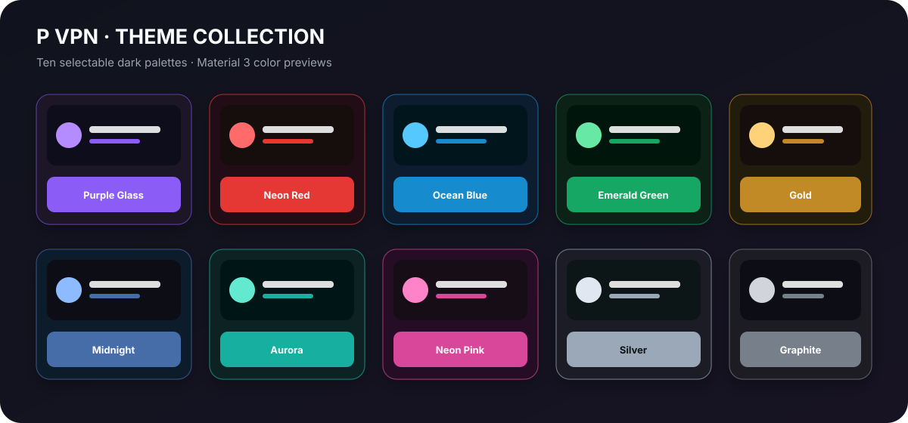

<div align="center">
  
  <h1>P VPN</h1>
  <p><strong>A customizable Android VPN client based on v2rayNG</strong></p>
  <p>
    <a href="README_FA.md">فارسی</a> ·
    <a href="https://github.com/mamadhoosh110-netizen/P-VPN/releases">Releases</a> ·
    <a href="https://github.com/2dust/v2rayNG">Upstream project</a>
  </p>
  <p>
    
    
    
    
  </p>
</div>

P VPN is a personal, open-source customization of [v2rayNG](https://github.com/2dust/v2rayNG). It keeps the upstream Android client foundation and adds a P VPN identity, a custom launcher icon, and ten selectable dark color palettes.

> P VPN is an independent community fork. It is not affiliated with or endorsed by the v2rayNG, Xray, or v2fly maintainers.

## Theme gallery

Choose a palette in **Settings → UI settings → P VPN theme**. The selected palette is saved locally and applied through the app's Material 3 color scheme.

<p align="center">
  
</p>

| Theme | Theme | Theme | Theme | Theme |
|---|---|---|---|---|
| Purple Glass | Neon Red | Ocean Blue | Emerald Green | Gold |
| Midnight | Aurora | Neon Pink | Silver | Graphite |

*The gallery above is a color-palette illustration, not a screenshot of the running app. Add real device screenshots to `docs/images/` when available.*

## P VPN customizations

- **P VPN app identity:** display name and a custom adaptive launcher icon featuring the letter P.
- **Ten dark palettes:** Purple Glass, Neon Red, Ocean Blue, Emerald Green, Gold, Midnight, Aurora, Neon Pink, Silver, and Graphite.
- **Persistent theme selection:** the selected palette is stored locally and restored when the app restarts.
- **Material 3 / Jetpack Compose:** theme colors are integrated into the existing Compose UI.
- **Original typography retained:** the upstream app font and typography have not been replaced.
- **Configuration workflows:** configuration import and backup/restore options remain available. Configuration-sharing entry points described in the project notes have been removed from the server list and backup screen.

## Download

When a release is published, download the APK files from [GitHub Releases](https://github.com/mamadhoosh110-netizen/P-VPN/releases). Until then, a debug build can be obtained from the successful **P VPN Android CI** workflow's `p-vpn-debug-apks` artifact (artifacts are temporary and retained for 14 days).

Only install APKs from a source you trust. Review the release notes and verify signatures when signature files are provided.

## Build from source

### Requirements

- Android Studio with Android SDK Platform **37** and Build Tools **37.0.0**
- JDK **21**
- Android NDK **30.0.16248370**
- Git and GitHub CLI (`gh`)
- Bash environment for the helper scripts (Linux, macOS, WSL, or Git Bash on Windows)

### Get the source

```bash
git clone --recurse-submodules https://github.com/mamadhoosh110-netizen/P-VPN.git
cd P-VPN
```

If you downloaded a source ZIP or the submodule folders are empty, initialize the pinned upstream dependencies:

```bash
bash prepare-submodules.sh
```

### Prepare native libraries

Set `NDK_HOME` to the installed NDK directory, then build the `hev-socks5-tunnel` native libraries and copy them into the Android app module:

```bash
export NDK_HOME="$ANDROID_HOME/ndk/30.0.16248370"
bash compile-hevtun.sh
mkdir -p V2rayNG/app/libs
cp -R libs/. V2rayNG/app/libs/
```

Download the Xray AAR matching the pinned `AndroidLibXrayLite` revision:

```bash
cd AndroidLibXrayLite
tag=$(git describe --tags --abbrev=0)
cd ..
gh release download "$tag" \
  --repo 2dust/AndroidLibXrayLite \
  --pattern 'libv2ray.aar' \
  --dir V2rayNG/app/libs
```

### Build a debug APK

Open the `V2rayNG` directory in Android Studio, or run the Gradle wrapper:

```bash
cd V2rayNG
./gradlew :app:assemblePlaystoreDebug
```

On Windows, use `gradlew.bat` from the `V2rayNG` directory:

```bat
gradlew.bat :app:assemblePlaystoreDebug
```

The debug APK output is under:

```text
V2rayNG/app/build/outputs/apk/playstore/debug/
```

The app module currently declares version name `2.3.15`, version code `755`, minimum Android API `24`, and target/compile SDK `37`. APK output names and ABI splits are configured in `V2rayNG/app/build.gradle.kts`.

## GitHub Actions

- **P VPN Android CI** (`.github/workflows/pvpn-ci.yml`) runs for pushes and pull requests targeting `main` or `master`, and can also be started manually. It prepares native dependencies, builds the Play Store debug APK, and uploads the APKs as the `p-vpn-debug-apks` artifact.
- **Build P VPN APK** (`.github/workflows/build.yml`) is a manual release workflow. A signed release requires the Android keystore and GPG secrets referenced by that workflow. Configure those secrets in the repository before running a signed release.

Never commit keystores, signing passwords, private keys, `local.properties`, or generated native binaries to the repository.

## Project layout

```text
P-VPN/
├── .github/workflows/       # CI and manual release workflows
├── AndroidLibXrayLite/      # Pinned upstream Xray Android library source
├── hev-socks5-tunnel/       # Pinned native tunnel dependency
├── V2rayNG/                 # Android Studio / Gradle project
│   ├── app/                 # Android application module
│   ├── gradle/              # Gradle version catalog and wrapper
│   └── ...
├── docs/images/             # README artwork
├── prepare-submodules.sh
└── compile-hevtun.sh
```

## Credits and license

P VPN is derived from [v2rayNG](https://github.com/2dust/v2rayNG) by its original contributors and uses upstream and third-party components. Keep the repository's [`LICENSE`](LICENSE), copyright notices, and applicable third-party license notices with redistributed source or binaries. Review the licenses of all bundled dependencies before distributing builds.

For issues specific to P VPN customizations, please use this repository's [Issues](https://github.com/mamadhoosh110-netizen/P-VPN/issues). For upstream v2rayNG functionality, consult the [upstream project](https://github.com/2dust/v2rayNG) and its documentation.
