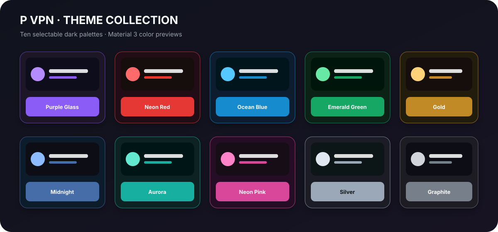

<div align="center">
  
  <h1>P VPN</h1>
  <p><strong>کلاینت VPN اندروید با قابلیت شخصی‌سازی، بر پایه v2rayNG</strong></p>
  <p>
    <a href="README.md">English</a> ·
    <a href="https://github.com/mamadhoosh110-netizen/P-VPN/releases">دریافت نسخه‌ها</a> ·
    <a href="https://github.com/2dust/v2rayNG">پروژه اصلی</a>
  </p>
</div>

**P VPN** یک فورک شخصی‌سازی‌شده و متن‌باز از [v2rayNG](https://github.com/2dust/v2rayNG) است. پایه اصلی کلاینت اندرویدی حفظ شده و هویت بصری P VPN، آیکون اختصاصی و ۱۰ پالت رنگی تیره به آن اضافه شده است.

> P VPN یک پروژه مستقل و جامعه‌محور است و وابستگی یا تأیید رسمی از سوی توسعه‌دهندگان v2rayNG، Xray یا v2fly ندارد.

## گالری تم‌ها

از مسیر **Settings → UI settings → P VPN theme** می‌توانید تم دلخواه را انتخاب کنید. انتخاب تم به‌صورت محلی ذخیره می‌شود و رنگ‌بندی آن در رابط Material 3 اعمال می‌شود.

<p align="center">
  
</p>

| تم | تم | تم | تم | تم |
|---|---|---|---|---|
| بنفش شیشه‌ای | قرمز نئونی | آبی اقیانوسی | سبز زمردی | طلایی |
| نیمه‌شب | شفق قطبی | صورتی نئونی | نقره‌ای | گرافیتی |

*تصویر بالا نمایش گرافیکی پالت‌های رنگی است و اسکرین‌شات واقعی از اجرای برنامه نیست. پس از تهیه اسکرین‌شات از گوشی می‌توانید تصاویر واقعی را به پوشه `docs/images/` اضافه کنید.*

## امکانات و شخصی‌سازی‌ها

- نام نمایشی **P VPN** و آیکون لانچر اختصاصی با حرف P.
- ۱۰ تم تیره: بنفش شیشه‌ای، قرمز نئونی، آبی اقیانوسی، سبز زمردی، طلایی، نیمه‌شب، شفق قطبی، صورتی نئونی، نقره‌ای و گرافیتی.
- ذخیره انتخاب تم و بازیابی آن پس از اجرای دوباره برنامه.
- هماهنگی رنگ‌ها با Material 3 و رابط Jetpack Compose.
- حفظ فونت و تایپوگرافی اصلی پروژه بالادستی.
- حفظ امکان واردکردن کانفیگ و پشتیبان‌گیری/بازیابی؛ مسیرهای اشتراک‌گذاری کانفیگ که در یادداشت‌های پروژه مشخص شده‌اند از فهرست سرورها و صفحه پشتیبان حذف شده‌اند.

## دریافت APK

پس از انتشار نسخه رسمی، فایل‌های نصب را از بخش [GitHub Releases](https://github.com/mamadhoosh110-netizen/P-VPN/releases) دریافت کنید. تا پیش از انتشار نسخه رسمی، می‌توانید Artifact مربوط به اجرای موفق گردش‌کار **P VPN Android CI** با نام `p-vpn-debug-apks` را از بخش Actions دریافت کنید. این Artifactها موقت هستند و ۱۴ روز نگهداری می‌شوند.

فقط APKهایی را نصب کنید که منبع آن‌ها را می‌شناسید و به آن اعتماد دارید. در صورت ارائه فایل امضا، اطلاعات انتشار و امضا را بررسی کنید.

## ساخت پروژه از سورس

### پیش‌نیازها

- Android Studio به همراه Android SDK Platform **37** و Build Tools **37.0.0**
- JDK **21**
- Android NDK **30.0.16248370**
- Git و GitHub CLI با دستور `gh`
- محیط Bash برای اجرای اسکریپت‌ها (Linux، macOS، WSL یا Git Bash در ویندوز)

### دریافت سورس

```bash
git clone --recurse-submodules https://github.com/mamadhoosh110-netizen/P-VPN.git
cd P-VPN
```

اگر پروژه را از ZIP دریافت کرده‌اید یا پوشه‌های زیرماژول خالی هستند، وابستگی‌های ثابت‌شده را آماده کنید:

```bash
bash prepare-submodules.sh
```

### آماده‌سازی کتابخانه‌های Native

متغیر `NDK_HOME` را به مسیر NDK نصب‌شده تنظیم کنید؛ سپس کتابخانه‌های `hev-socks5-tunnel` را بسازید و در ماژول اندروید قرار دهید:

```bash
export NDK_HOME="$ANDROID_HOME/ndk/30.0.16248370"
bash compile-hevtun.sh
mkdir -p V2rayNG/app/libs
cp -R libs/. V2rayNG/app/libs/
```

فایل AAR مربوط به Xray را مطابق نسخه زیرماژول `AndroidLibXrayLite` دریافت کنید:

```bash
cd AndroidLibXrayLite
tag=$(git describe --tags --abbrev=0)
cd ..
gh release download "$tag" \
  --repo 2dust/AndroidLibXrayLite \
  --pattern 'libv2ray.aar' \
  --dir V2rayNG/app/libs
```

### ساخت APK آزمایشی

پوشه `V2rayNG` را در Android Studio باز کنید یا از Gradle Wrapper استفاده کنید:

```bash
cd V2rayNG
./gradlew :app:assemblePlaystoreDebug
```

در ویندوز می‌توانید از `gradlew.bat` در پوشه `V2rayNG` استفاده کنید:

```bat
gradlew.bat :app:assemblePlaystoreDebug
```

مسیر خروجی APKهای Debug:

```text
V2rayNG/app/build/outputs/apk/playstore/debug/
```

در حال حاضر تنظیمات ماژول برنامه شامل version name برابر `2.3.15`، version code برابر `755`، حداقل Android API برابر `24` و compile/target SDK برابر `37` است. نام APK و تفکیک ABI در فایل `V2rayNG/app/build.gradle.kts` تنظیم شده‌اند.

## ساخت خودکار با GitHub Actions

- گردش‌کار **P VPN Android CI** در فایل `.github/workflows/pvpn-ci.yml` با Push و Pull Request به شاخه‌های `main` یا `master` و همچنین اجرای دستی فعال می‌شود. این گردش‌کار وابستگی‌های Native را آماده می‌کند، APK آزمایشی Play Store را می‌سازد و خروجی را با نام `p-vpn-debug-apks` ذخیره می‌کند.
- گردش‌کار **Build P VPN APK** در فایل `.github/workflows/build.yml` برای انتشار دستی است. انتشار امضاشده به Secrets مربوط به keystore اندروید و کلید GPG نیاز دارد؛ پیش از اجرای آن باید این Secrets را در تنظیمات مخزن تعریف کنید.

هرگز keystore، رمزهای امضا، کلید خصوصی، فایل `local.properties` یا باینری‌های Native تولیدشده را در مخزن عمومی قرار ندهید.

## ساختار پروژه

```text
P-VPN/
├── .github/workflows/       # گردش‌کارهای CI و انتشار دستی
├── AndroidLibXrayLite/      # سورس نسخه‌بندی‌شده کتابخانه Xray
├── hev-socks5-tunnel/       # وابستگی تونل Native
├── V2rayNG/                 # پروژه اندروید و Gradle
│   ├── app/                 # ماژول برنامه
│   ├── gradle/              # Version Catalog و Wrapper
│   └── ...
├── docs/images/             # تصاویر README
├── prepare-submodules.sh
└── compile-hevtun.sh
```

## سپاس‌گزاری و مجوز

P VPN بر پایه [v2rayNG](https://github.com/2dust/v2rayNG) و مشارکت‌های توسعه‌دهندگان آن ساخته شده و از اجزای بالادستی و کتابخانه‌های ثالث استفاده می‌کند. هنگام بازنشر سورس یا فایل‌های اجرایی، فایل [`LICENSE`](LICENSE)، اعلان‌های حق نشر و مجوزهای وابستگی‌ها را حفظ کنید. پیش از توزیع نسخه‌های ساخته‌شده، مجوز تمام وابستگی‌های همراه را بررسی کنید.

برای مشکلات مربوط به شخصی‌سازی‌های P VPN از بخش [Issues](https://github.com/mamadhoosh110-netizen/P-VPN/issues) استفاده کنید. برای مشکلات مربوط به نسخه اصلی v2rayNG، به [مخزن اصلی](https://github.com/2dust/v2rayNG) مراجعه کنید.
